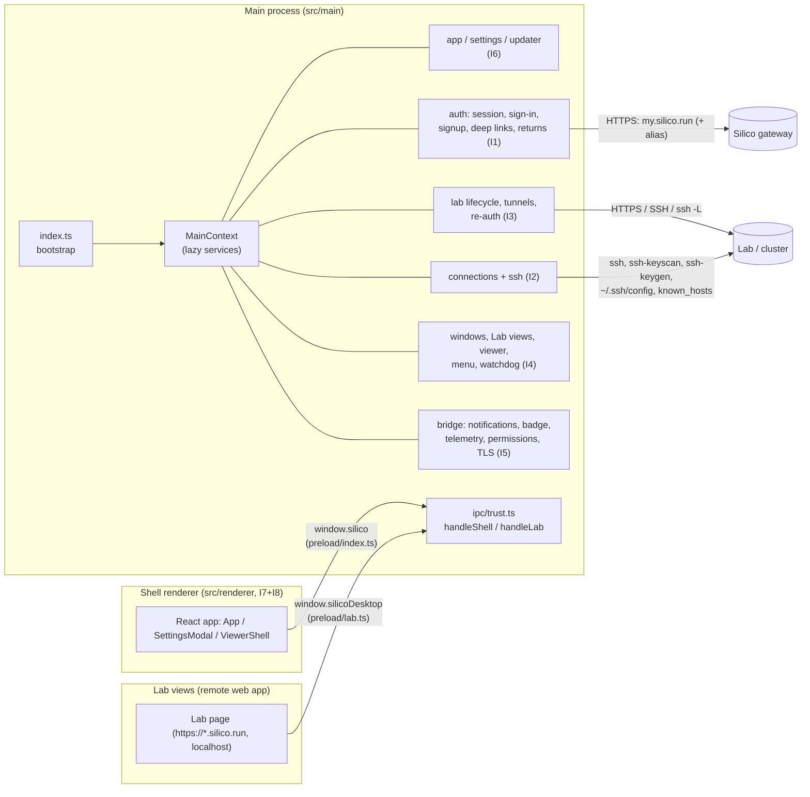

# Rea Claude: architecture

Rea Claude is a clean-room TypeScript reimplementation of the Silico desktop
connection manager (Electron, Goodfire, v0.137.0). Behavior is defined by the
specs in [`docs/spec/`](spec/). This document is the **shared contract** for
the eight parallel implementers: process model, module boundaries, file
ownership, service interfaces, startup order, product decisions and
deliberate deviations, and the testing strategy.

Spec shorthand used below: `auth`, `conn-ssh` (connections-ssh), `lab`
(lab-lifecycle), `windows` (windows-labview-menu), `bridge` (lab-bridge),
`platform` (settings-updater-lifecycle), `renderer` (renderer-ui), `design`
(design-system).

---

## 1. Overview

### Process model

| Process / surface | Code | Session | Preload | Trust gate |
|---|---|---|---|---|
| Main | `src/main/**` | – | – | – |
| Shell window, settings sheet, viewer strip | `src/renderer/**` (hash selects `App` / `SettingsModal` / `ViewerShell`) | default | `out/preload/index.js` → `window.silico` | shell-trusted: frame URL is the app's own renderer `index.html` (or, unpackaged only, the `ELECTRON_RENDERER_URL` origin); X17 |
| Lab view (one per shell window) | remote Lab page | `persist:silico` | `out/preload/lab.js` → `window.silicoDesktop` | lab-trusted: `sender.session === fromPartition("persist:silico")` |
| Viewer content view | remote page | `persist:silico` | lab preload only when `labBridge` | lab-trusted |
| Signup view (inside a shell window) | `<gateway>/beta-signup` | `persist:silico-signup` | none (sandboxed) | – |

Preloads are built with `isolatedEntries: true` so each is a single
self-contained CJS file that only `require("electron")`; they work under
`sandbox: true`.

---

## 2. Shared files (architect-owned, frozen)

| File | Purpose |
|---|---|
| `src/shared/config.ts` | Every constant: identity, env var names, gateways and paths, partitions, file names, timeouts, limits, window geometry, settings defaults, TLS blocklist. Cite spec sections. |
| `src/shared/ipc.ts` | Channel-name constants (`ShellInvokeChannel`, `ShellEventChannel`, `LabInvokeChannel`, `LabSendChannel`, `LabEventChannel`), all payload types, typed channel maps (`ShellInvokeMap`, `ShellEventMap`, `LabInvokeMap`, `LabSendMap`, `LabEventMap`), `SilicoApi`, `SilicoDesktopApi`. |
| `src/shared/global.d.ts` | `window.silico: SilicoApi`, `window.silicoDesktop?: SilicoDesktopApi`. |
| `src/main/services.ts` | Service interfaces, `MainContext`, `createMainContext()` (lazy getters). |
| `src/shared/sshTarget.ts` | `sshTargetError` / `isSafeSshToken`: SSH host/user/jump validation shared by I2 and I3 (D5.6). |
| `src/main/ipc/trust.ts` | `configureShellTrust`, `makeShellUrlMatcher`, `isTrustedShellSender`, `isLabSender`, `handleShell`, `handleLab`, `onShell`, `onLab`, `sendShell`, `sendLab`, `blockedError`. |
| `src/preload/index.ts`, `src/preload/lab.ts` | Fully implemented bridges. |
| `electron.vite.config.ts`, `tsconfig*.json`, `vitest.config.ts`, `package.json` | Build config. |
| `tests/main/trust.test.ts`, `tests/main/services.test.ts`, `tests/main/preload.test.ts`, `tests/main/helpers/**` | Shared tests and the `makeTestContext` helper. |

**Change requests.** Implementers do not edit shared files. If you need a new
constant, channel, payload field, or service method, write it up (file, exact
TS diff, reason) in your final report; the architect applies it. Until then,
keep module-local constants in your own area and do not invent IPC channels.

---

## 3. File ownership (disjoint)

| Id | Area | Owns (source) | Owns (tests) | Entry file exports (frozen signatures) |
|---|---|---|---|---|
| I1 | Auth | `src/main/auth/**` | `tests/main/auth/**` | `createAuthService`, `createSignupService`, `createDeepLinkService`, `createReturnsService`, `registerAuthIpc` |
| I2 | Connections + SSH | `src/main/connections/**`, `src/main/ssh/**` | `tests/main/connections/**`, `tests/main/ssh/**` | `createConnectionsService`, `registerConnectionsIpc`; `createSshService`, `registerSshIpc` |
| I3 | Lab lifecycle | `src/main/lab/**` | `tests/main/lab/**` | `createLabLifecycleService`, `registerLabIpc` |
| I4 | Windows | `src/main/windows/**` | `tests/main/windows/**` | `createWindowService`, `registerWindowsIpc` |
| I5 | Lab bridge | `src/main/bridge/**` | `tests/main/bridge/**` | `createTelemetryService`, `createBridgeService`, `registerBridgeIpc` |
| I6 | Platform | `src/main/settings/**`, `src/main/updater/**`, `src/main/app/**`, final wiring of `src/main/index.ts`, `resources/**` | `tests/main/settings/**`, `tests/main/updater/**`, `tests/main/app/**` | `createSettingsService`, `registerSettingsIpc`; `createUpdaterService`, `registerUpdaterIpc`; `createAppEnv`, `createLoggerFactory`, `runPreReadyBootstrap`, `registerAppIpc`, `offerMoveToApplications`, `applyDockIcon`, `installAppLifecycleHooks` |
| I7 | Renderer logic | `src/renderer/index.html`, `src/renderer/src/**` **except** `styles/` | `tests/renderer/**` | – |
| I8 | Renderer styles | `src/renderer/src/styles/**` (incl. `@fontsource` imports) | – | `styles/index.css` (imported once by I7's `main.tsx`) |
| A | Architect | everything in §2 | `tests/main/*.test.ts`, `tests/main/helpers/**` | – |

**Allowed intra-owner import:** `src/main/app/**` may import
`../updater/bundle` (`relaunchOntoDiskBundleIfNewer`, pre-ready step 4); both
areas belong to I6, so this is not a cross-module import in the §4.1 sense.

Each area's `index.ts` is currently a stub (throws `not implemented: …` or
returns a safe default). Replace the bodies; keep the exported names and
signatures. Split your area into as many files as you like under your own
directory. `deps?: <X>Deps` (the second argument of `create*`) is yours to
define for test injection (clock, paths, fetch, spawn...).

I7/I8 interface: I7 writes BEM class names exactly as listed in the renderer
spec (§2-§4) and design spec; I8 styles those names. I7's `main.tsx` imports
`./styles/index.css` (I8 must create it; until then I7 may keep the import
commented out). The renderer reaches main only through `window.silico`.

---

## 4. Module contract (main process)

1. **No cross-module imports.** Code in `src/main/<area>/` imports only
   `electron`, `node:*`, npm deps, `@shared/*`, `../services`, `../ipc/trust`,
   and files inside its own area. Other areas are reached via `ctx.<service>`.
2. **Registration.** All IPC goes through `handleShell` / `handleLab` /
   `onLab` (never raw `ipcMain`). All sends go through `sendShell` / `sendLab`
   or `ctx.windows.broadcast*`.
3. **Lazy context.** `create<X>Service(ctx, deps?)` runs before `app.whenReady`
   and before other services exist: it must not touch other services, call
   ready-only Electron APIs, or start timers/listeners. Do that in
   `install*()` / `start()` / `register*Ipc()`, which the bootstrap calls in
   order (§6). Reading `ctx.x` before `x` is provided throws.
4. **Untrusted input.** IPC arguments are typed per contract but arrive
   unvalidated. Lab `send` payloads are passed as `unknown`.
5. **Logging.** `ctx.logger("<tag>")` (console, `[tag]` prefix; tags per
   platform §6.4).

### Service interfaces (summary; full docs in `src/main/services.ts`)

| Service (`ctx.*`) | Owner | Key methods |
|---|---|---|
| `env: AppEnv` | I6 | `isPackaged`, `isTestMode`, `platform`, `appVersion`, `build`, `rendererUrl`, `userDataPath()`, `preloadPath()`, `rendererHtmlPath()`, `iconPath()` |
| `logger: LoggerFactory` | I6 | `(tag) => Logger` |
| `settings: SettingsService` | I6 | `get`, `set` (no broadcast), `onChanged` |
| `updater: UpdaterService` | I6 | `isEnabled`, `getState`, `install`, `start`, `checkInBackground`, `userCheck` |
| `telemetry: TelemetryService` | I5 | `recordShellEvent`, `drainShellEvents`, `markCause` (`D`), `markRecent` (`qe`), `installForegroundTracker`, `reportMainProcessError` |
| `bridge: BridgeService` | I5 | `installCertificateVerifier`, `installPermissionHandlers`, `clearBadgeCounts` |
| `auth: AuthService` | I1 | `status`, `persistenceMode`, `logPersistenceMode`, `activeGateway`, `cachedIdentity`, `lastIdentity`, `getSession`, `gatewayRequest`, `noteLabToken`, `isDeveloper`, `onIdentityChanged`, `onSignedIn`, `onDeveloperChanged`, `recordSessionDeath` |
| `signup: SignupService` | I1 | `open`, `close`, `isOpen`, `relayout`, `isSignupWebContents` |
| `deepLinks: DeepLinkService` | I1 | `handle` (stashes until ready), `markReady`, `findInArgv` |
| `returns: ReturnsService` | I1 | `begin`, `takeMcpOauthReturn`, `takeGithubConnectReturn`, `install` |
| `connections: ConnectionsService` | I2 | `list`, `get`, `upsert`, `remove` |
| `ssh: SshService` | I2 | `ensureShellEnv`, `runRemote`, `spawnTool`, `sshArgs`, `sshDest`, `classifyHostKey`, `classifySshError` |
| `lab: LabLifecycleService` | I3 | `openLab` (`Ge`), `reauthOnAuthWall` (`rs`), `rewake` (`xt`), `resumePendingReauths`, `cancelWindow` (`ts`), `forgetWindow`, `closeTunnel`, `killAllTunnels`, `listLabs`, `createLabSession`, `waitForLab` |
| `windows: WindowService` | I4 | shell windows (`createShellWindow`, `focusOrCreateShellWindow`, `ensureShellWindow`, `primaryShellWindow`, `activateWindow`, `broadcast`, `broadcastToTrustedShells`, `applySignOut`, `attachContextMenu`), Lab views (`openLabInWindow`, `hideLabView`, `revealIfHidden`, `findLab`, `windowForConn`, `labWebContentsForConn`, `shownLabWebContents`, `viewerWebContents`, `onLabReady`, `setReauthing`, `waitForShellRenderer`, `resendLabOpened`, `currentLabReturnTo`, `destroyAllLabViews`, `invalidateShownViews`), bridge-facing (`handleRecoverSession`, `openDesktopSettingsFor`, `openLabSwitcherFor`, `classifyFocusedWindow`), navigation (`openSettingsSheet`, `navigateMenu`, `openShareViewer`), startup (`installMenus`, `startBackgroundMonitors`) |

### Cross-area responsibilities that are easy to get wrong

| Concern | Decision |
|---|---|
| Re-auth in place (`rs`/`xt`/`ns`, pending resume after sign-in, `lab:cancel` clearing parked re-auths) | **I3** owns the logic, the per-window open epoch and the cooldown map; it drives the view through `ctx.windows.setReauthing / waitForShellRenderer / resendLabOpened / hideLabView / currentLabReturnTo` and sends `lab:state` / `auth:expired` to the window itself. I4 calls `ctx.lab.reauthOnAuthWall` (auth wall seen, readiness auth-wall probe, Lab `recoverSession`) and `ctx.lab.rewake` (crash, watchdog, memory un-park, resume). `lab:hide` from the user → I4 reads `reauthing`, calls `ctx.lab.cancelWindow(win.id)`, then hides; window `closed` → `ctx.lab.forgetWindow(win.id)` (X20). |
| SSH tunnels | I3, keyed by window id. I4 calls `ctx.lab.closeTunnel(id)` on window `closed`; I6 calls `ctx.lab.killAllTunnels()` on `before-quit` and before update install. |
| Viewer recovery controller | I4 (state machine, `/api/auth/config` fetch, UI states), using `ctx.auth` (session/identity, `onSignedIn`) and `ctx.lab.createLabSession` / `ctx.lab.waitForLab`. |
| Signup view | I1 owns the view; I4 calls `ctx.signup.close(win)` on shell `did-start-loading` and `closed`, and `ctx.signup.relayout(win)` on resize/zoom. Signup adoption uses `ctx.lab.listLabs`, `ctx.connections.upsert`, `ctx.lab.openLab`, `ctx.windows.hideLabView`. |
| Deep links | I6 collects URLs (argv at module load, `open-url`, `second-instance`) and calls `ctx.deepLinks.handle(url)`. I1 parses and dispatches: welcome → `ctx.windows.focusOrCreateShellWindow("deep-link:welcome")`; open → `ctx.windows.openShareViewer`; returns → nonce stores + `ctx.windows.findLab/windowForConn/revealIfHidden/activateWindow`. |
| Lab bridge handlers | I5 registers every `silico:*` channel. `recover-session` → `ctx.windows.handleRecoverSession(event)`; `begin-*`/`take-*` → `ctx.returns` with `ctx.windows.findLab(sender)?.connId ?? null`; `open-desktop-settings` / `open-lab-switcher` → `ctx.windows.*For(sender)`; `drain` → `ctx.telemetry`. |
| Lab-ready hooks | `ctx.windows.onLabReady`: I1 (pending checkout outcome, registered in `returns.install()`), I5 (pending notification route). |
| Settings listeners | `ctx.settings.onChanged`: I4 (developer menu), I5 (badge recompute). `settings:changed` broadcast is done by I6's IPC handler. |
| Developer menu rule | I4 (`installMenus`) combines `ctx.settings` and `ctx.auth.isDeveloper()/onDeveloperChanged` (platform §4.1). |
| Badge clear | I1 sign-out-all and I3 re-auth "expired" call `ctx.bridge.clearBadgeCounts()`. |
| Telemetry kinds | `connect-outcome`, `reauth-outcome` (I3); `down-panel`, `viewer-stranded` (I4); `session-death`, `gateway-transport-failure` (I1). Foreground causes via `ctx.telemetry.markCause` by whoever focuses a window. |
| `uncaughtException`, `web-contents-created`, `child-process-gone` | I6 installs; delegates to `ctx.telemetry.reportMainProcessError`, `ctx.windows.attachContextMenu(wc)`, `ctx.windows.invalidateShownViews()` (GPU, non clean-exit, after `GPU_GONE_INVALIDATE_DELAY_MS` = 1 s). |
| Power resume update check | I4's `startBackgroundMonitors` calls `ctx.updater.checkInBackground()` 2 s after a resume that followed a ≥ 60 s suspend (platform §6.1 step 18). |
| Parked re-auths on activation | I4's `did-become-active` handler calls `ctx.lab.resumePendingReauths()` (platform §6.1 step 19). |
| Menu "Check for Updates…" | I4 menu calls `ctx.updater.userCheck()`. |

### IPC registration ownership

| Channels | Registered by |
|---|---|
| `ping`, `app:isDevBuild` | I6 (`registerAppIpc`) |
| `settings:get`, `settings:set` | I6 (`registerSettingsIpc`) |
| `update:get-state`, `update:install` | I6 (`registerUpdaterIpc`) |
| `auth:status`, `auth:persistence`, `auth:signIn`, `auth:signOutAll`, `signup:open`, `signup:close`, `signup:status` | I1 |
| `connections:list`, `connections:upsert`, `connections:remove` | I2 (`registerConnectionsIpc`) |
| `ssh:listHosts`, `ssh:addHost`, `dialog:pickFile`, `lab:test`, `lab:hostKey:scan`, `lab:hostKey:accept` | I2 (`registerSshIpc`) |
| `lab:status`, `lab:connect`, `lab:update`, `lab:cancel`, `lab:down`, `lab:open`, `local:detectStacks`, `labs:list` | I3 |
| `window:is-initial`, `window:set-compact`, `window:open-settings-sheet`, `lastOpened:get`, `lastOpened:set`, `labs:held-elsewhere`, `labs:focus-held`, `lab:hide`, `lab:goBack`, `lab:goForward`, `viewer:retry`, `dialog:confirm` | I4 |
| every `silico:*` channel (`LabInvokeChannel`, `LabSendChannel`) | I5 |

Events (main → renderer) are sent by the area that owns the behavior:
`lab:output`/`lab:phase` (I3), `lab:opened`/`lab:state`/`lab:viewvis`/
`lab:navstate`/`viewer:*`/`app:navigate` (I4; I3 also sends `lab:state` and
`auth:expired` during re-auth; I1 sends `app:navigate("connections")` before
deep-link signup), `auth:*`/`signup:*`/`connections:changed` (I1),
`settings:changed`/`update:state` (I6), `silico:navigate`/`silico:foreground`/
`silico:shell-event-nudge` (I5), `silico:*-return` (I1), `silico:report-issue` (I4 menu).

---

## 5. Contract details resolved by the architect

- **`AuthState` / `ConnectOutcome` / `OpenResult` / `UpdateState`** use the
  exact shapes from the auth, lab and platform specs. `lab:open` returns the
  raw `OpenResult` (windows spec's looser `{status, url?}` is the same thing).
- **`Connection`** keeps `name`, `icon`, `deploymentId`, `labUrl` as required
  strings (the renderer always writes them), but main treats every field
  defensively because the store is unvalidated.
- **`UpdateState` when disabled** is `{phase: "idle", currentVersion}` (the
  spec's field is `phase`, not `state`).
- **Gateway calls**: lab code never handles proofs. It calls
  `ctx.auth.gatewayRequest({path, method, body})` and branches on
  `kind: "http" | "auth" | "network"` and HTTP status (403 forbidden, 409
  claim, …). 401 is consumed inside auth (drops the session, returns `auth`).
  After a lab token is obtained, call `ctx.auth.noteLabToken(token)`.
- **`-dev` suffix** for non-managed deployment ids on staging is applied by
  I3 (`createLabSession` and its own calls); staging is
  `(await ctx.auth.activeGateway()) === GATEWAY_STAGING`.
- **`window:set-compact`** argument `compact` is typed `boolean`; main still
  applies `!!compact` as the original does.

---

## 6. Startup order (platform §6.1)

`src/main/index.ts`:

- **A. Services** (side-effect free): `env`, `logger`, `settings`,
  `telemetry`, `auth`, `signup`, `deepLinks`, `returns`, `connections`, `ssh`,
  `lab`, `windows`, `bridge`, `updater`; assert none missing.
- **B. `runPreReadyBootstrap(ctx)`** (I6, module-load steps 1-12): forbidden
  switches (exit 78, packaged only) → delete `SSLKEYLOGFILE` → `setName`
  (`PRODUCT_NAME`) + `setPath("userData", <appData>/rea-claude)` or
  `REA_CLAUDE_E2E_USER_DATA` + `setAppUserModelId(APP_ID)` → disk-bundle
  relaunch check → single-instance lock (packaged only) → about panel →
  `uncaughtException` → `web-contents-created` (`will-prevent-unload`,
  context menu) → `child-process-gone` (GPU) → protocol registration (D3) →
  deep-link intake (`argv`, `open-url`, `second-instance` → `ctx.deepLinks.handle`).
- **C. whenReady** (only if the lock was acquired):
  1 `bridge.installCertificateVerifier` · 2 `ssh.ensureShellEnv` (not awaited)
  · 3-4 `telemetry.installForegroundTracker` · 5 `bridge.installPermissionHandlers`
  · 6 `offerMoveToApplications` · 7 `applyDockIcon` · 8 all `register*Ipc`
  · 9 `auth.logPersistenceMode` · 10 `returns.install`, `windows.installMenus`
  (menu, developer wiring, dock menu, 10-12) · 13 `windows.createShellWindow({initial:true})`
  · 14 `deepLinks.markReady` · 15 `updater.start` · 16 `installAppLifecycleHooks`
  (activate, window-all-closed, before-quit) · 17-20 `windows.startBackgroundMonitors`.

---

## 7. Decisions

**D1 Separate identity.** `productName` "Rea Claude", `appId`
`dev.smilefactory.rea-claude`, `app.setName("Rea Claude")` and userData
`<appData>/rea-claude` set before ready, so Rea Claude never reads or writes the
real Silico's `~/Library/Application Support/Silico`. On-disk formats inside
userData are identical to the original (`settings.json` v2,
`connections.json` v1, `identity.json` v1, …). App chrome (window titles,
about panel, update dialogs, launch-guard text, document title) uses
`PRODUCT_NAME`; copy that refers to the Silico service, its Labs or its legal
terms keeps saying "Silico". The E2E override env var is
`REA_CLAUDE_E2E_USER_DATA` (original `SILICO_E2E_USER_DATA`).

**D2 Interop surface kept.** `window.silico`, `window.silicoDesktop`, every IPC
channel name, the gateway endpoints (prod `https://my.silico.run`, staging
`https://my-staging.silico.run`, aliases `https://silico.goodfire.com`,
`https://silico-staging.goodfire.com`), partitions (`persist:silico`,
`persist:silico-signup`) and remote CLI conventions are unchanged and
centralized in `src/shared/config.ts` / `src/shared/ipc.ts`.

**D3 Deep links.** `silico://` URLs are always handled internally (intercepted
navigations such as `silico://signup-ready`, plus argv / `open-url` /
`second-instance` when the OS delivers them). Rea Claude calls
`app.setAsDefaultProtocolClient("silico")` **only** when
`REA_CLAUDE_REGISTER_PROTOCOL=1` (and packaged), so it does not hijack the real
Silico. The packaged `Info.plist` must not declare `CFBundleURLSchemes:
["silico"]` unless that env-gated mode is the intended deployment.

**D4 Updater disabled by default.** The updater is wired only when
`REA_CLAUDE_UPDATE_URL` is set (generic provider; packaged builds). Otherwise
`update:get-state` returns `{phase:"idle", currentVersion}`, `update:install`
is a no-op, no timers run, and the macOS menu "Check for Updates…" shows an
informational dialog. Never point at Silico's CloudFront feed (that would
install the real Silico). The Windows Authenticode + pinned SSL.com CA check is
not implemented (we have no signing identity); electron-updater's own check
still applies when enabled.

**D5 Security fixes (deliberate deviations).**
1. `window:open-settings-sheet`, `labs:held-elsewhere`, `labs:focus-held` use
   the shell-trusted gate (`handleShell`); `window:open-settings-sheet` keeps its
   extra "sender is the shell window's own webContents" check.
2. Host-key accept: `lab:hostKey:accept(target, expectedFingerprint)` rescans,
   fingerprints every scanned line, and appends **only** lines whose SHA256
   fingerprint equals `expectedFingerprint`; none → `{ok:false, error}`. The
   renderer must therefore always scan and show the fingerprint before
   accepting, including ConfigureForm's "Accept host key & add" path (deviation
   from the original UI, which accepted blind).
3. `ssh:addHost` writes `IdentityFile "<path>"` (double-quoted) when the path
   contains whitespace; a path containing `"` is rejected with
   `The identity file path must not contain double quotes.`
4. Loopback detection (`isLoopbackUrl`, tunnel decision) accepts `localhost`,
   `127.0.0.1`, `::1` **and** `[::1]` (the original's `::1` never matched).
5. `connections.json` that fails to parse → rename to
   `connections.json.corrupt-<epoch ms>`, log `[connections] …`, continue with
   `[]` (original threw on every list/upsert). Other read errors still reject.
6. **SSH argument injection.** A Connection's `ssh.host`, `ssh.user` or
   `ssh.jump` (from IPC or from the unvalidated `connections.json`) that begins
   with `-` (e.g. `-oProxyCommand=…`), or contains whitespace/control
   characters (for `jump`: any hop or `@`-host part beginning with `-`), is
   never passed to `ssh` / `ssh-keyscan` / `ssh-keygen`.
   `src/shared/sshTarget.ts` validates centrally; I2 rejects in `runRemote`
   (returns `{code:255, stderr:"Invalid host name."}` and friends, so callers
   surface it as an ssh error), `lab:test`, `lab:hostKey:scan/accept` (also
   rejects an option-looking `hostname` from `ssh -G`); I3 rejects in the
   tunnel manager. Errors: `Invalid host name.` / `Invalid user name.` /
   `Invalid jump host.`. Argv builders additionally put `--` before the
   destination (`ssh … -- <dest> <cmd>`, tunnel `… -L … -- <dest>`,
   `ssh -G -- <host>`, `ssh-keyscan … -- <host>`). The manual-tunnel hint text
   is unchanged.

**D6 Fonts and assets.** Inter (for the commercial Suisse Intl), IBM Plex Mono
and Newsreader via the `@fontsource` packages. No assets are copied from the
original app; an original placeholder icon goes in `resources/` (I6).

### Other deviations chosen by the architect

| # | Deviation | Why |
|---|---|---|
| X1 | `silico:recover-session` is registered with `handleLab` (partition check) in addition to the recovery-registry gate. | Defence in depth; legitimate callers are always in `persist:silico`. |
| X2 | Shell, settings-sheet and viewer windows use `sandbox: true` (original `false`). | Preloads are self-contained bundles that need only `electron`. |
| X3 | Renderer "Accept host key & add" shows the scanned fingerprint first (see D5.2). | Consequence of D5.2. |
| X4 | No Windows Authenticode/CA-pinning updater check. | D4; no signing identity. |
| X5 | `:focus-visible` outline in styles (design §8.1). | Accessibility; I8 may add. |
| X6 | Updater cache dir `rea-claude-updater`; E2E env var renamed (D1). | Separate identity. |

### Deviations introduced by implementers (integration review)

| # | Deviation | Where | Why |
|---|---|---|---|
| X7 | `auth.onSignedIn` also fires after signup identity-proof adoption (`adoptSignupProof`, auth §4.5 step 5), not only after browser sign-in. | I1 `auth/core.ts` | Parked re-auths and viewer recovery resume after either kind of sign-in. |
| X8 | `auth.activeGateway()` falls back to the gateway picked by `settings.staging` when signed out. | I1 | Spec leaves the signed-out case open; lab/ssh staging checks need a value. |
| X9 | `silico:open-desktop-settings` / `silico:open-lab-switcher` sends are partition-gated (`onLab`) in addition to the windows-side sender checks. | I5 `bridge/ipc.ts` | Defence in depth, like X1. |
| X10 | Malformed connection over IPC is rejected with `Invalid connection.` (lab) / `A connection must be an object.` (connections store) instead of the original's incidental `TypeError`. | I2, I3 | Untrusted input (§4.4). |
| X11 | `settings:set` patches are restricted to the known setting keys; unknown keys (and `version`) are dropped. Values are still not validated. | I6 `settings/sanitize.ts` | Prevent junk keys from persisting in `settings.json`. |
| X12 | ConfigureForm awaits `onSave` before closing/advancing (errors stay on the form). | I7 | Avoids losing the form on a failed save. |
| X13 | Host-key accept mismatch error text is new: "The host key … no longer matches the fingerprint you approved (…). Nothing was trusted; …". | I2 `ssh/hostkey.ts` | Consequence of D5.2 (no original text exists). |
| X14 | Renderer app-chrome brand strings say "Rea Claude" (`lib/copy.ts`, `Shells.tsx`, `KeyringNotice.tsx`); Silico service/Lab/legal copy keeps "Silico". | I7 | D1. |
| X15 | `LabRef.labOrigin` is the origin of the URL handed to `openLabInWindow` (tracked by I4); I5's mic permission check uses it directly instead of capturing the origin at lab-ready. Unknown (`null`) origin still denies. | I4, I5 | Single source of truth for the Lab origin. |
| X16 | Viewer recovery records the identity to watch for account switches from `auth.cachedIdentity()` (sync, now carrying `gatewayUrl`), and I3 parks "expired" re-auths with `auth.lastIdentity()`: the module-level published `{sub, gatewayUrl}` that survives a session drop (gateway/refresh 401/404) and is cleared only by sign-out, never `activeGateway()`. | I1, I3, I4 | Matches the original's module identity (auth §3.1), so a same-account sign-in after a session drop reopens the Lab; avoids the settings fallback (X8) misattributing a parked identity. |
| X17 | Shell IPC trust requires the sender URL to be the app's own renderer `index.html` (`pathToFileURL` of the built path; hash/query ignored) or, in unpackaged builds only, the dev-server origin. The original trusted any `file:` URL and read `ELECTRON_RENDERER_URL` on every check, packaged or not. The values are resolved once (`createAppEnv` → `configureShellTrust` in `index.ts`). Shell, settings-sheet and viewer-strip windows also block `will-navigate` / `will-redirect` to anything else, which includes Chromium's navigate-on-file-drop. | `ipc/trust.ts`, `app/index.ts`, `windows/service.ts` | A downloaded or dropped local HTML file, or an env var in a packaged app, must not get `window.silico`. |
| X18 | Loopback sign-in: a `/callback` whose `s` does not match the attempt's state gets the 400 page but does **not** settle the attempt; it keeps waiting for the real callback (or timeout/cancel). A matching state with a missing proof still fails with "Sign-in failed (state mismatch or missing proof).". The original rejected on any `/callback`. | I1 `auth/loopback.ts` | A stale tab or a local page probing the port must not abort the user's sign-in. |
| X19 | SSH tunnel auto-reconnect: a failed respawn (`spawnTool` `ok:false` or throw) counts as a failed attempt and schedules the next backoff; after the 6th attempt, or when ssh is missing on a retry read, the tunnel is torn down (`isActive` false) after the log line. The original left a dead tunnel marked active with no further retry. | I3 `lab/tunnel.ts` | A dead tunnel must not force re-auth reopens onto a port nothing listens on. |
| X20 | User hide during a re-auth: windows reads `reauthing` **before** `lab.cancelWindow` (which clears it), so `userLeft` is actually recorded (windows §4.2 step 2); `cancelWindow` also clears I3's per-window re-auth state (reauthing / 45 s cooldown); a fresh (non-recovery) `openLab` clears the window's reauth flags so a leftover `userLeft` cannot swallow the user's own next open; window close calls `lab.forgetWindow` so per-window epochs/parked re-auths do not accumulate. Lab loads are identified by a per-entry sequence number as well as their start time. | I3, I4 | Literal ordering in the spec made `userLeft` unreachable; cooldown surviving a user hide blocked the next legitimate re-auth. |

Everything else (including quirks marked *Observed* in the specs, such as
`lab:connect` reporting `opened` for `other`/`still-waking` on the cluster
path, `ssh -G` overriding an explicit port, LIFO MCP returns, the 401/404 =
"ready" readiness probe, `connections:changed` only after signup) is kept
faithfully. An implementer who believes another quirk is a bug must list it in
their report rather than silently changing it.

---

## 8. Testing strategy

- **Runner:** vitest (`npm test`). Main/shared tests run in Node; renderer
  tests add `// @vitest-environment jsdom` and use `@testing-library/react`.
- **Pure first.** Every spec §8 "pure functions and test cases" table becomes
  unit tests in the owning area (parsers, regexes, classifiers, geometry,
  decision tables, state reducers). Put pure logic in Electron-free files so
  it tests without mocks.
- **Electron boundary.** Mock `electron` with `vi.mock("electron", …)` (see
  `tests/main/trust.test.ts`). Use `makeTestContext({...})` from
  `tests/main/helpers/context.ts` to fake other services: unspecified
  services/methods throw `not stubbed: <svc>.<method>`, so unexpected
  collaboration fails loudly.
- **Time and I/O.** Inject `now`, `sleep`, timers (`vi.useFakeTimers`), fetch,
  spawn and file paths through your `deps`; use temp dirs for fs tests.
- **Contract tests (architect).** `trust.test.ts` (gates and exact error text),
  `preload.test.ts` (bridge shapes, defaults, pull-on-signal),
  `services.test.ts` (lazy context).
- **Gate.** `npm run typecheck && npm test && npm run build` (= `make check`)
  must stay green after every change. No network or real SSH in tests.
