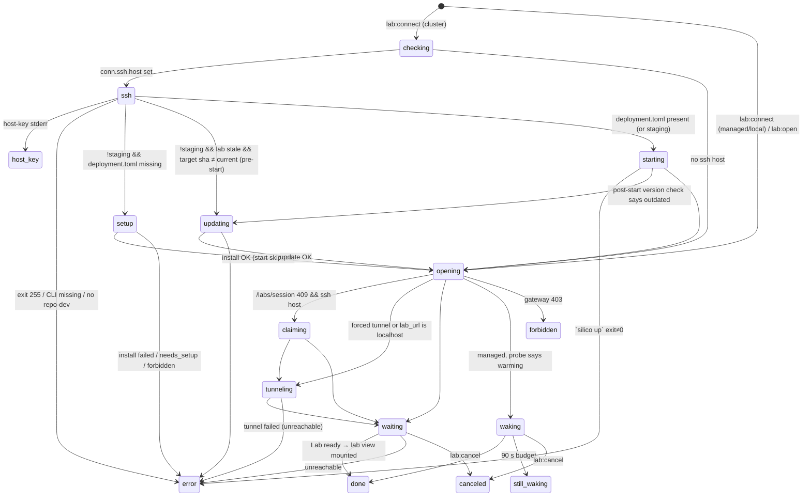

# Lab lifecycle: provisioning, starting, updating, stopping, tunneling

Source: Silico.app v0.137.0 (`ai.goodfire.silico`). Line numbers below are from `pretty/main.js` (abbreviated `M:`), `pretty/renderer.js` (`R:`) and `pretty/preload-index.js` (`P:`). This spec is clean-room: it describes behavior only.

---

## 1. Overview

The desktop app does not run Lab software itself. A **Lab** is a remote web app (the Silico Lab UI and API). It runs in one of three places:

| routeMode | Where the Lab runs | How the app reaches it | Who starts it |
|---|---|---|---|
| `cluster` (default) | The user's HPC/GPU cluster, started by the remote `silico` CLI (`silico-dev` when using the staging gateway) | Over HTTP at the `lab_url` from the gateway, or through an `ssh -L` tunnel when that URL is localhost or the user asks for one | The app runs `silico up` over SSH |
| `managed` | Hosted by Goodfire | Public HTTPS from the gateway | Woken by the gateway. The app only polls it |
| `local` | A developer's local docker compose stack (dev builds only) | `http://localhost:<port>` | The developer (`make local-dev`). The app only checks that it is up |

The main process talks to two kinds of server:
- **Auth gateway** (`https://my.silico.run`, or `https://my-staging.silico.run` for staging; alias origins `https://silico.goodfire.com` and `https://silico-staging.goodfire.com`). Calls are `/labs` (discovery), `/labs/session` (Lab token + URL), `/labs/claim` (bind a route), `/labs/setup-bearer` (one-time bearer for install/update) and `/install` (the installer script, fetched on the cluster by `curl`).
- **The Lab itself**: `/healthz`, `/api/cluster/version`, `/healthz/dataplane`, `/auth/callback`.

"Staging" means the signed-in gateway is `https://my-staging.silico.run` (`se()`, M:1712-1716). It is not read directly from the settings flag. When staging is true, the remote CLI is `silico-dev`, the remote state dir is `~/.silico/state/_dev`, and deployment ids get a `-dev` suffix.

**Lab vs Connection**
- *Discovered Lab* (`labs:list`): a gateway-side deployment record that belongs to the signed-in user. It carries routing, liveness (`stale`) and version info. It is fetched again every 20 s (R:19613-19618).
- *Connection*: a locally persisted record in `<userData>/connections.json`, as `{version:1, connections:[...]}`. It is written atomically through a `.tmp` file and a rename (M:155-200). The user opens connections, and every lifecycle IPC takes a Connection. The renderer auto-creates Connections for discovered **managed** Labs, with id `managed:<login>:<deploymentId>:<gatewayUrl>` (R:19885-19935). *Local stacks* become ephemeral Connections with id `local:<project>`, which are kept in renderer state and never persisted (R:20401-20410, R:20064-20076).

The final output of a successful lifecycle operation is a call to the lab-view module (`Bo`, M:3695) with the URL `<base>/auth/callback?return_to=<enc>#token=<labToken>`. That module mounts a `WebContentsView` and emits `lab:opened` (see Cross-area notes).

---

## 2. IPC contract

Every channel below is registered through the guarded `y()` wrapper (M:6428-6437). The wrapper rejects any sender whose frame URL is not `file:` and does not match the `ELECTRON_RENDERER_URL` origin, with `Error("Blocked '<ch>': untrusted sender.")`. Events are sent only to the requesting `webContents`, and only if it is not destroyed (`Le`, M:6415-6417).

```ts
type RouteMode = "cluster" | "managed" | "local";
interface SshTarget { host: string; user?: string; port?: number; identityFile?: string; jump?: string }
interface Connection {
  id: string; name?: string; icon?: string;
  deploymentId?: string; labUrl?: string; routeMode?: RouteMode;
  ssh?: SshTarget; owner?: string; gatewayUrl?: string; dismissed?: boolean;
}
type ConnectOutcome =
  | { status: "opened"; labUrl?: string }          // labUrl = conn.labUrl || undefined (NOT the session URL)
  | { status: "canceled" }
  | { status: "forbidden"; login?: string }
  | { status: "still-waking" }
  | { status: "error"; message: string }
  | { status: "host-key"; host: string; kind: "changed" | "unknown" }
  | { status: "needs-setup" };                      // no message field
type OpenResult =                                   // raw result of Ge()
  | { status: "opened" } | { status: "canceled" } | { status: "forbidden"; login?: string }
  | { status: "unreachable"; url: string } | { status: "still-waking" } | { status: "other" };
type Phase = "checking"|"ssh"|"setup"|"starting"|"updating"|"opening"|"claiming"|"tunneling"|"waiting"|"waking";
interface LocalStack { project: string; port: number; worktree?: string; branch?: string }
interface DiscoveredLab {
  deploymentId: string; labPublicHost: string; routeMode: RouteMode;
  host?: string; port?: number; stale: boolean;
  currentSha?: string; targetSha?: string; minSha?: string;
  updateAvailable: boolean; updateRequired: boolean; reportsVersion?: boolean;
}
type LabsListResult =
  | { ok: true; labs: DiscoveredLab[]; gatewayUrl: string; login: string }
  | { ok: false; error: string; needsAuth?: true };
```

| Channel | Dir | Args | Returns | Behavior | Errors |
|---|---|---|---|---|---|
| `lab:status` | R→M invoke | `url: string` (base URL) | `"up"\|"down"\|"unknown"` | `GET new URL("/healthz", url)` with a 5 s abort. 2xx gives `up`. Non-2xx or an exception gives `down`. An empty or falsy url gives `unknown` (M:4155-4165) | never throws |
| `lab:connect` | R→M invoke | `conn: Connection, verbose = false, opts?: {tunnel?: boolean}` | `ConnectOutcome` | Full start-and-open flow (`tu`, M:4673). Streams `lab:output` and `lab:phase`. Logs telemetry `connect-outcome` `{path:"connect", managed, status, ms}` (M:6628-6656) | rejects if spawn throws a non-ENOENT error |
| `lab:update` | R→M invoke | `conn, opts?: {preview?: boolean}` | `ConnectOutcome` | `silico update` over SSH, then opens the Lab (`oo`, M:4788). Never tunnels by force | as above |
| `lab:cancel` | R→M invoke | `connId: string` | `void` | Aborts the in-flight wait loops and SSH child for this connection (`nu`, M:4866) | – |
| `lab:down` | R→M invoke | `conn` | `void` | Runs `silico down --yes` over SSH. Output goes to `lab:output`. No phase events (`ou`, M:4873) | rejects only on spawn error |
| `lab:open` | R→M invoke | `conn, opts?: {reachTimeoutMs?: number}` | `OpenResult` | Opens an already-running Lab without starting it (`Ge`). The budget is clamped to [1000, 120000] ms, default 3000 (`xs`, M:37-42). Emits `lab:phase`. Telemetry `{path:"open", budgetMs,...}` | – |
| `local:detectStacks` | R→M invoke | – | `LocalStack[]` | `docker ps` scan (`Yd`, M:6460-6476) | returns `[]` on any failure |
| `labs:list` | R→M invoke | – | `LabsListResult` | `GET <gw>/labs` (`It`, M:1947) | see §4.6 |
| `lab:output` | M→R event | `{id: connId, chunk: string}` | – | Raw stdout and stderr chunks from SSH children, plus the app's own progress lines. Each ends in `\n` | – |
| `lab:phase` | M→R event | `{id: connId, phase: Phase}` | – | Phase transitions | – |

Related channels in other areas: `lab:test`, `lab:hostKey:scan`, `lab:hostKey:accept`, `lab:hide/goBack/goForward`, and the events `lab:opened`, `lab:state`, `lab:navstate`, `lab:viewvis`.

---

## 3. State machine

### 3.1 Phases

The main process emits only the 10 `Phase` values. The renderer adds `stopping` (set locally before `lab:down`) and the terminal UI phases `done`, `error`, `host-key`, `needs-setup`, `forbidden`, `still-waking` (R:19303-19341). The renderer applies an incoming `lab:phase` only while the row's current phase is in RUNNING = {the 10 + `stopping`} (R:19626-19632). Late phase events after a terminal state are therefore ignored.



Terminal results map to renderer phases as follows. `opened` and `canceled` both become `done`. Every other status becomes the phase of the same name (R:20000-20011).

### 3.2 In-memory state (main process)

```ts
// Per connection id (single slot each; a 2nd concurrent op on the same id overwrites)
const opAbort   = new Map<string, AbortController>();      // Re: long SSH command (setup/up/update)
const opChild   = new Map<string, ChildProcess>();         // ce: running ssh child for that command
const waitAborts= new Map<string, Set<AbortController>>(); // Q: readiness-poll loops
// Per BrowserWindow id
const tunnels   = new Map<number, TunnelState>();          // gt (keyed by WINDOW id, one tunnel per window)
const openEpoch = new Map<number, number>();               // _e: bumped on every Ge(); stale ops return "canceled"
interface TunnelState {
  ssh: SshTarget; staging: boolean; localPort: number;
  child: ChildProcess | null; closed: boolean; armed: boolean;
  onLog?: (s: string) => void; retries: number; lastSpawnAt: number;
  backoff: NodeJS.Timeout | null;
}
```

Renderer per-row state is `{phase, startedAt, log: string, message?, host?, hostKeyKind?}`, created by `mkConnState` (R:19362-19364).

---

## 4. Flows

Common helpers:
- `remote(cmd)` = ssh exec (§5.1).
- `PATHX(cmd)` = `PATH="$PATH:$HOME/.local/bin" <cmd>` (`wt`, M:4154).
- `CLI` = `silico-dev` when staging, else `silico` (`an`, M:246).
- `STATE` = `state/_dev` when staging, else `state` (`Zr`, M:249).
- `depId(x)` = x + `-dev` when staging, unless it already ends in `-dev` (`kt`, M:252).

### 4.1 `lab:connect(conn, verbose, {tunnel})` (`tu`, M:4673-4786)

1. Clear the window's re-auth cooldown (`z.delete(win)`).
2. **managed/local**: call `openLab(conn, win, log, budget=90000 default, phase, tunnel)` (§4.7). Then map the result:
   - opened → `{opened, labUrl: conn.labUrl||undefined}`
   - forbidden → forbidden
   - still-waking and canceled pass through
   - unreachable → error: "The app couldn't reach this Lab at ${url}. Check your internet connection, then try again."
   - anything else → error: "This Lab couldn't be opened right now. If it keeps happening, reach out to Goodfire on Slack."
3. Emit phase `checking`.
4. If `conn.ssh.host`:
   1. Emit phase `ssh` and log "Checking the cluster over SSH…".
   2. Run `remote('test -f "$HOME/.silico/deployment.toml"')`.
   3. Host-key classification of stderr: "remote host identification has changed" → `{host-key, kind:"changed"}`. "host key verification failed" → `{host-key, kind:"unknown"}`. Return either one.
   4. Exit code 255 → `{error, message: classifySshError(res)}` (§5.4).
   5. **Staging only**:
      - `remote(PATHX("command -v silico-dev >/dev/null 2>&1"))` must exit 0. Otherwise log and return error: "The dev CLI (silico-dev) isn't installed on this cluster. On its login node, update the Silico CLI, then run `silico-dev setup`."
      - `remote('test -d "$HOME/silico-repo-dev"')` must exit 0. Otherwise return error: "This cluster has no staging (dev) environment yet. SSH to its login node and run:\n  silico-dev setup\nthen try Connect again."
   6. **Not staging and deployment.toml missing**: run first-time setup (§4.2). If it returns a result, return it. If it succeeds, **the start step is skipped**, because the guard `staging || toml-exists` is false. Inferred: the installer brings the Lab up itself.
   7. If staging or the toml exists:
      - **Pre-start stale check** (not staging, has deploymentId, settings `previewBuilds` and `skipVersionCheck` both false): call `labs:list`. If the discovered Lab is `stale` and `needsExactUpdate(lab)` (§8), log "This Lab isn’t confirmed on the latest version. Updating it as it starts." and return `update(conn, win, cbs, preview=false, tunnel)`.
      - Emit phase `starting`. `cmd = "<CLI> up"`, plus ` --verbose` if `verbose`. Log "Starting the Lab (\`<cmd>\`). This can take a few minutes…".
      - Run `remote(PATHX(cmd))` with streaming, registered in `opAbort`/`opChild` (cancellable).
      - Results: tool missing → error with the stderr text. Exit ≠ 0 → error "\`<cmd>\` exited <code|(stopped)>.\n<last 600 chars of trimmed stderr>".
5. **Post-start version check** (has ssh host and deploymentId, `skipVersionCheck` false):
   - `preview = !staging && previewBuilds`, `pinned = !staging && !preview`.
   - `pollOutdated(depId, {pinnedExactCheck: pinned})` makes up to 4 `labs:list` attempts, 1500 ms apart. It returns `updateFlags(lab).any` for the first non-stale match, else false (`eu`, M:4662).
   - If outdated → return `update(conn, win, cbs, preview, tunnel)`.
6. Emit phase `opening` and call `openLab(conn, win, log, 90000, phase, tunnel)`. Map the result:
   - unreachable → error. With a tunnel (`tunnel` or localhost url): "The Lab started but the app couldn't reach it through the SSH tunnel. The login node may not reach the compute node. See Logs for the manual `ssh -L` command to try directly." Otherwise: "The Lab started but the app can't reach it at ${url} yet. It may be behind a VPN/Tailscale, or still coming up. Try Open again in a moment."
   - forbidden and canceled pass through.
   - **Every other status, including `other` and `still-waking`, becomes `{opened, labUrl: conn.labUrl||undefined}`.** Observed quirk: a session-exchange error falls back to opening the browser (§4.7 step 6) and still reports "opened".

### 4.2 First-time setup (`Ql`, M:4612-4661)

1. No deploymentId → log "This connection has no deployment to set up automatically." and return `{needs-setup}`. No ssh host gets the same result with the message "…no SSH host to set up over."
2. Emit phase `setup` and log "First time on this cluster. Setting it up…".
3. `POST <gw>/labs/setup-bearer {deployment_id: depId(id)}`. 403 → forbidden (§5.4). Other failure → log "Couldn't authorize setup: <err>" and return `{needs-setup}`.
4. Build the command (every value is single-quoted with `'` → `'\''`, `ge`, M:4599):
   `curl -fsSL '<gw>/install' | SILICO_LAB_AUTH_URL='<gw>' SILICO_CLUSTER_ID='<deploymentId raw>' SILICO_SETUP_BEARER='<bearer>' bash -s -- --tenant '<deploymentId raw>'`
   The command has **no** PATH prefix. `<gw>` has trailing slashes stripped.
5. Log "Installing and configuring Silico on the cluster (first time only)…". Run it with streaming. It is cancellable.
6. Tool missing → error with the stderr. Exit ≠ 0 → error "First-time setup exited <code|(stopped)>.\n<stderr tail 600>". Success returns `null`, and the caller continues.

### 4.3 `lab:update(conn, {preview})` (`oo`, M:4788-4865)

1. No ssh host → log and return error "No SSH host configured for this connection.". No deploymentId → error "No deployment configured for this connection.".
2. `usePreview = preview && !staging`. `cmd = "<CLI> update"`, plus ` --preview` when `usePreview`.
3. Emit phase `updating`. Log either "Updating the Lab to the preview (staging) build. This stops it, pulls the staging branch, and restarts. Can take a few minutes." or "Updating the Lab. This stops it, pulls the latest build, and restarts. Can take a few minutes.". Then log "Nothing is lost; your threads, experiments, and data pick up where they were.".
4. Get a setup bearer (as in §4.2). On failure: forbidden, or error "Couldn't authorize the update: <err>".
5. Run `remote(PATHX("SILICO_CLUSTER_ID='<depId(id)>' SILICO_SETUP_BEARER='<bearer>' <cmd>"))` with streaming. It is cancellable. Exit ≠ 0 → error "\`<cmd>\` exited …\n<stderr tail 600>".
6. Emit phase `opening` and call `openLab(..., tunnel)`. The tunnel is `false` from IPC, or is inherited when called from connect. Unreachable → error, either "Updated, but the app couldn't reach the Lab through the SSH tunnel. See Logs for the manual `ssh -L` command." (localhost url) or "Updated, but the app can't reach the Lab at ${url} yet. Try Open again in a moment.". Every other status maps as in 4.1 step 6.

### 4.4 `lab:down(conn)` (`ou`, M:4873-4893)

1. No ssh host → output "No SSH host configured." and return.
2. Output "Stopping the Lab (\`<CLI> down\`)…".
3. Run `remote(PATHX("<CLI> down --yes"))` with output streamed. It is **not** registered for cancellation and has no timeout.
4. Output the stderr if the tool is missing. Otherwise output "Stopped." (exit 0) or "\`<CLI> down\` exited <code>.".
5. Returns void. It does not close the window's tunnel or lab view.

Renderer side (R:20254-20280): `stopLab` refuses while any RUNNING phase is active. It sets `stopping`. On resolve it adds the deploymentId to the local `stopped` set (treated as not live) and sets `done`. A rejection becomes an error with the message "Stopping the Lab failed unexpectedly.". The menu item "Stop Lab" appears only in developer mode, for live, non-managed, non-busy rows.

### 4.5 `lab:cancel(connId)` (`nu`, M:4866-4872)

1. For each pending re-auth entry (`le`) with this connId, invalidate that window's epoch (`ts`). Any in-flight `Ge` for that window then resolves `canceled`.
2. `opAbort.get(id)?.abort()`. This only stops a pending spawn: `q` checks the signal before and right after spawn. A running child is not stopped by the signal.
3. Abort every readiness-poll controller in `waitAborts.get(id)`. The loops exit on their next check, which comes within ≤1.5 s sleep plus ≤5 s probe.
4. `opChild.get(id)?.kill("SIGTERM")` and delete it. The SSH child exits with code `null`, so the result shows "(stopped)".

Cancel does **not** tear down a tunnel being set up, and it does not stop a `lab:down`. Renderer `cancelOpening` also adds the id to `cancelledOpens`. If a `lab:opened` for that id arrives later, the renderer calls `labView.hide()` (R:19638-19641).

### 4.6 `labs:list` (`It`, M:1947-1972)

1. Get a session proof, refreshing it if needed (auth area). If the account changed mid-call → `{ok:false, error:"The signed-in account changed. Please try again."}`. No session → "Your session has expired. Sign in again." with `needsAuth:true`, or "Session refresh is temporarily unavailable.".
2. `GET <gw>/labs` with `authorization: Bearer <proof>`, a 10 s timeout per origin, and origin fallback to the alias host.
3. 401 → auth-expiry handling. Non-OK → "Discovery failed (HTTP <n>).". An exception → its message, with ` (<code>)` appended when a safe error code exists (`wn`, M:1940-1946).
4. Map each `labs[]` item (`wc`, M:2136-2152):
   - `kind` maps to routeMode: `managed` stays `managed`, `local` stays `local`, anything else becomes `cluster`.
   - `deploymentId` is kept as-is for managed. Otherwise a trailing `-dev` is stripped.
   - `labPublicHost = lab_public_host ?? ""`, `stale = (stale !== false)`.
   - Version fields are copied. `updateAvailable` and `updateRequired` are strict `=== true`.

Renderer reachability: for each non-stale discovered Lab with host and port, it calls `lab:status(labBaseUrl(host,port))` every 20 s. `labBaseUrl` returns `https://host` when the port is 443, `https://host:port` for `*.silico.run`, and `http://host:port` otherwise (R:19392-19396, R:19820-19846).

### 4.7 Open a Lab (`Ge`, M:4345-4441), shared by connect, update, open, and re-auth

Signature: `(conn, win, log, reachBudgetMs=90000, phase, forceTunnel=false, {recoveryEpoch, returnTo, browserFallback})`.

1. Bump the window's epoch, unless a `recoveryEpoch` is given. After each await, if the epoch moved, return `canceled`.
2. **managed** (`Kl`, M:4249):
   - Requires deploymentId; otherwise log and return `other`.
   - Emit phase `opening`. `POST /labs/session {deployment_id: <raw>}`. 403 → forbidden. Other error → log and return `other`.
   - Run the wake-poll (§5.3) with `unreachableTimeoutMs = reachBudget` and `timeoutMs = 90000`.
   - canceled → log "Stopped.". unreachable → log "Couldn't reach the Lab at <url>." and return `unreachable`. still-waking → log "The Lab is taking longer than usual to start — try again in a moment.".
   - ready → close the window's tunnel and mount `<labUrl>/auth/callback?return_to=<enc(returnTo??"/")>#token=<token>` with title `name||deploymentId||"Lab"`.
3. **local** (`ql`, M:4310):
   - Requires labUrl.
   - Emit phase `opening`. `lab:status(labUrl)` must be `up`. Otherwise log "The local dev stack isn't reachable at <url>.\nStart it from that worktree with \`make local-dev\` (or docker/dev/local-dev.sh up), then try again." and return unreachable.
   - `POST /labs/session {deployment_id:<raw>, lab_url: labUrl}`, then mount as above. There is no readiness poll.
4. **cluster** with deploymentId:
   1. `POST /labs/session {deployment_id: depId(id)}`.
   2. If HTTP 409 and the ssh host is set: emit phase `claiming` and run the claim (§4.8).
   3. On success, the base is `session.labUrl`. If `forceTunnel` or the URL's hostname is `localhost`/`127.0.0.1`/`::1`:
      - No window → log "Cannot open an SSH tunnel without a window." and return unreachable.
      - Emit phase `tunneling` and run the tunnel (§5.2). On failure, log the error and return unreachable (url = session URL).
      - Base = `http://localhost:<port>`.
      - If no tunnel is needed, close any tunnel this window has.
   4. Emit phase `waiting` and run the cluster readiness poll (§5.3) with `reachBudgetMs`.
   5. ready → log "Authenticated. Opening the Lab." and mount. canceled → "Stopped.". Otherwise log "The Lab is running but the app couldn't reach it at <base>." and return unreachable.
   6. Session failure: 403 → forbidden. Otherwise log the error and fall through.
5. **Fallback** (cluster with no deploymentId, or a session error):
   - If `browserFallback === false` → log "Couldn't re-establish the Lab session automatically." and return `other`.
   - Otherwise build `<gw>/?return_to=%2F&deployment=<depId(id)>` (deployment param only if set), log "Opening <url> …", call `shell.openExternal` and return `other`.

Forbidden helper (`Rt`, M:4222): logs "Your GitHub account (@login) isn't authorized for this Lab. You may be signed in with the wrong account." and returns `{forbidden, login}`.

### 4.8 Route claim (`Xl`, M:4581-4608)

1. Log "First time on this cluster. Binding your Lab to your account automatically (no need to open the claim link above).".
2. `remote('cat "$HOME/.silico/<STATE>/claim.token" 2>/dev/null')`. A missing tool, exit ≠ 0 or empty output → "Couldn't read this cluster's claim token over SSH to bind your route.".
3. `POST <gw>/labs/claim {deployment_id: depId(id), claim_token_hash: sha256hex(token)}`. On success the response is `{token, lab_url}`, used like a session. On 409: "This cluster has a stale route from a previous session. Open this once in your browser to re-bind, then reconnect:\n  <gw>/claim#t=<rawToken>".

### 4.9 `local:detectStacks` (M:6460-6476, parser `Gs` M:130-150)

1. `execFile("docker", ["ps","--filter","name=silico-local-","--format", "{{.Names}}\t{{.Ports}}\t{{.Label \"com.silico.local.worktree\"}}\t{{.Label \"com.silico.local.branch\"}}"], {timeout: 5000})`. This uses the plain process env and does not wait for the login-shell env import.
2. Parse each line by splitting on TAB into name, ports, worktree and branch. Skip the line if name or ports is empty. Take the **first** match of `(127.0.0.1|0.0.0.0|[::1]):(\d+)->5173/tcp` in ports. Accept the port only if it is an integer in 1..65535. `project = name` with a trailing `-web-<digits>` removed. Empty or whitespace worktree and branch become `undefined`.
3. Any error (docker missing, timeout, non-zero exit) → `[]`.
4. Renderer: polls only when `isDevBuild && settings.staging`, every 3 s and on window focus (R:19950-19971). Each stack becomes a Connection with `id: "local:<project>"`, `deploymentId: "goodfire-local"`, `labUrl: "http://localhost:<port>"`, `routeMode: "local"` and icon `cpu`. Its name comes from `localStackName`: a branch other than main/master/HEAD/staging gives the last path segment of the branch. Otherwise the worktree is used. Otherwise `silico-local-` in the project name is replaced with `local ` (R:17761-17783).

### 4.10 Renderer dispatch (R:20219-20244), for context

Open button:
- If `!skipVersionCheck`, not managed, and `updateFlags(disc,{pinnedExactCheck: !previewPinned && !staging}).any` → `lab:update`.
- Else if the discovered Lab is non-stale, not in `stopped`, and reach is not `unreachable` → `lab:open` with budget 3000 ms when known reachable, else 90000 (R:17812-17819).
- Otherwise → `lab:connect(c, verbose)`.

Developer menu: "Open via SSH tunnel" calls `connect(c,{tunnel:true})`.

---

## 5. External commands & network

### 5.1 SSH exec (`q`, M:783-813, argv `_a`/`pi` M:768-782)

- **Spawn**: `spawn(sshCmd, args)`, no shell, default env. The binary is resolved as `ssh`. On ENOENT under win32 it tries `%SystemRoot%\System32\OpenSSH\ssh.exe`. The resolved path is cached per tool (`Io`, M:719-745).
- **Tool missing**: if every candidate fails, the result is `{code:255, stdout:"", stderr:<install hint>, toolMissing:true}`. The hint reads "The OpenSSH client isn't installed on this machine (couldn't find `ssh`). Silico uses it to connect to clusters." plus platform advice (M:705-711).
- **argv**: `-o BatchMode=yes -o ConnectTimeout=10 [-i <identityFile> -o IdentitiesOnly=yes] [-p <port>] [-J <jump>] <user@host|host> <remoteCmd>`. The remote command is a single argv element, interpreted by the remote login shell.
- **Before the first spawn**: `Co()` runs once, except on win32. It launches `$SHELL` (or `os.userInfo().shell`, or `/bin/bash`) with `-ilc` (`-c` for csh/tcsh). The shell prints `__SILICO_SHELL_ENV__`, then `env`, then the marker again. It has a 5 s timeout, after which it is SIGKILLed. The captured `SSH_AUTH_SOCK` is imported, and `PATH` is prepended and de-duplicated (M:631-698).
- **Streaming**: stdout and stderr chunks are UTF-8 decoded and forwarded through `onLog(chunk)`, with no line buffering. They are also accumulated for the result `{code, stdout, stderr}`.
- **Timeouts**: none at the process level, apart from ssh's own ConnectTimeout=10.

Remote commands (all observed):

| Purpose | Remote command line |
|---|---|
| deployment probe | `test -f "$HOME/.silico/deployment.toml"` |
| staging CLI probe | `PATH="$PATH:$HOME/.local/bin" command -v silico-dev >/dev/null 2>&1` |
| staging repo probe | `test -d "$HOME/silico-repo-dev"` |
| first-time install | `curl -fsSL '<gw>/install' \| SILICO_LAB_AUTH_URL='<gw>' SILICO_CLUSTER_ID='<dep>' SILICO_SETUP_BEARER='<bearer>' bash -s -- --tenant '<dep>'` |
| start | `PATH="$PATH:$HOME/.local/bin" silico[-dev] up [--verbose]` |
| update | `PATH="$PATH:$HOME/.local/bin" SILICO_CLUSTER_ID='<dep[-dev]>' SILICO_SETUP_BEARER='<bearer>' silico[-dev] update [--preview]` |
| stop | `PATH="$PATH:$HOME/.local/bin" silico[-dev] down --yes` |
| tunnel target | `echo "$(cat "$HOME/.silico/<STATE>/lab-host.txt" 2>/dev/null)\|$(cat "$HOME/.silico/<STATE>/lab-port.txt" 2>/dev/null)"`, parsed as `host\|port`. The port must be an integer > 0 and the host non-empty (`Ji`, M:3956-3967) |
| claim token | `cat "$HOME/.silico/<STATE>/claim.token" 2>/dev/null` |

The app never writes files on the remote host directly. Everything remote is done by the installer and the `silico` CLI. Known remote paths are `~/.silico/deployment.toml`, `~/.silico/state[/_dev]/{lab-host.txt,lab-port.txt,claim.token}`, `~/silico-repo-dev` and `~/.local/bin`. The app does not choose images or versions: `silico update` pulls "the latest build", or the staging branch with `--preview`. The version target comes from the gateway's `current_sha`/`target_sha`.

### 5.2 SSH tunnel (`Hl`, M:4091-4150, spawn `Yi` M:4008-4039, reconnect `Zi` M:4040-4074)

1. Fail if there is no `ssh.host` ("No SSH host configured for the tunnel."). Close any existing tunnel for this **window id** and register a new state.
2. Read the remote host and port (5.1). A missing tool returns that error. Unparseable output gives "Couldn't read the Lab's host/port over SSH to open a tunnel.".
3. Allocate a local port by having `net.createServer().listen(0,"127.0.0.1")` grab the port and then close (`Fl`). Failure gives "Could not allocate a local port for the tunnel.". Log "Opening an SSH tunnel to the Lab (localhost:<p>)…".
4. Spawn `ssh <base opts from 5.1> -N -o ServerAliveInterval=15 -o ServerAliveCountMax=3 -o ExitOnForwardFailure=yes -L <p>:<labHost>:<labPort> <target>`. A spawn failure returns its message.
5. Readiness: try a TCP connect to `127.0.0.1:<p>` every 250 ms for up to 8000 ms (`Nl`).
   - Success: set `armed=true` and return `http://localhost:<p>`.
   - Failure: close the tunnel and return "The SSH tunnel to the Lab did not come up. The login node may not reach the compute node. You can try it manually:\n  ssh -N [-i id] [-p port] [-J jump] -L <p>:<host>:<port> <target>".
6. After any await, if the state was closed (replaced): "Tunnel setup was replaced by a newer connect.".
7. **Auto-reconnect**, when an armed child exits and the state is not closed:
   - If the child lived ≥ 60 s, reset `retries`.
   - Backoff = `min(1000·2^retries, 8000)` ms, with at most 6 retries. After that, log "SSH tunnel dropped and could not be re-established. Reconnect to retry.".
   - Each retry re-reads host and port. If the read fails it schedules the next backoff. If it succeeds, log "SSH tunnel dropped. Reconnecting…" and respawn on the **same** local port.
8. **Teardown** (`B`): mark closed, clear the backoff, SIGTERM the child. Teardown happens on window `closed` (M:7333), on `before-quit` (M:7802), before an update install (M:5959), when an open doesn't need a tunnel, and on managed/local opens.

### 5.3 HTTP probes

- `lab:status`: Node global `fetch` `GET <base>/healthz` with a 5 s timeout. 2xx is up.
- Cluster readiness (`zl`, M:4231-4248):
  - Probe `GET <base>/api/cluster/version` with `Authorization: Bearer <labToken>` via `electron.net.fetch` and a 5 s timeout.
  - HTTP 425 or ≥500 gives `warming`. **Any other status (including 401/404) gives `ready`.** A network error gives `unreachable`.
  - Loop: on ready, return. On the first non-ready probe, log "Lab started. Waiting for it to be ready…". Sleep 1500 ms.
  - At the deadline (`reachBudgetMs`), return `ready` if any probe was ever `warming`, else `unreachable`. The abort signal is checked before and after each probe.
- Managed wake (`yi`, M:1001-1044): the same probe, but on a network error it falls back to `GET <base>/healthz/dataplane` (3 s, `redirect:"manual"`, `no-store`). HTTP 200 there counts as `warming`.
  - Each distinct error code is logged once: "Couldn't reach the Lab (<code>) — retrying…".
  - The first `warming` emits phase `waking` and logs "Starting your Lab — this usually takes under a minute…".
  - Once warming has been seen, the deadline is `timeoutMs` (90 s) and the result is `still-waking`. Before that, the deadline is `min(unreachableTimeoutMs, timeoutMs)` and the result is `unreachable`. Polling interval is 1500 ms.

### 5.4 Error classification (`hi`/`gi`, M:815-845)

Host key: "remote host identification has changed" means `changed`. "host key verification failed" means `unknown`.

`classifySshError(res)`:
- Tool missing → the stderr text.
- `host key verification failed|no matching host key` → the literal string `"host-key"`.
- "permission denied" → "SSH was refused (publickey). If your key has a passphrase, add it to your ssh-agent (`ssh-add`) or use a passphrase-less key — the app cannot prompt for one. Otherwise check the key registered with us matches your SSH config."
- "timed out" → "SSH timed out. Check the host and your network / VPN."
- "could not resolve" / "name or service not known" → "Could not resolve the SSH host. Check the host name."
- "connection refused" → "SSH connection refused. Check the host and port."
- Otherwise → the last 2 lines of stderr, or `ssh exited <code>`.

Gateway calls (`ue`, M:1882) refuse any origin other than the two gateways ("Refusing to send gateway credentials to an unknown origin."). The default timeout is 10 s per attempt. With originFallback they try the canonical host first, then its alias.

---

## 6. Security notes

- IPC sender allowlist: only `file:` frames or the dev-server origin may invoke lifecycle channels.
- Every value interpolated into a remote shell string goes through POSIX single-quote escaping (`ge`), except the fixed literals. Note: `ssh.host`, `user`, `jump` and `identityFile` become argv elements, not shell code. Their validation is in the SSH-hosts area (`Ln`, which rejects whitespace and control characters, applies only to `ssh:addHost`).
- `BatchMode=yes` means ssh never prompts, so passphrase keys need an agent. `SSH_AUTH_SOCK` is imported from the login shell.
- `SILICO_SETUP_BEARER` is passed on the remote command line. It is visible in the remote process list and possibly in shell history or audit logs. It is short-lived but deserves care.
- The Lab token travels in the URL **fragment** (`#token=`), so it is never sent to the server in the request line. The claim token in the 409 message is also in a fragment.
- The installer is `curl | bash` from the gateway origin.
- The cluster readiness probe treats 401/403/404 as "ready". This is intentional (liveness, not auth), but a reimplementation should keep it so the behavior matches.
- The tunnel binds only to 127.0.0.1 (ssh default `-L` bind address). There is a short race between free-port discovery and ssh binding, and `ExitOnForwardFailure` makes that race fail loudly.
- `lab:status` accepts an arbitrary URL from the renderer and fetches `/healthz` on it. This is a minor SSRF-ish primitive, limited to trusted renderer origins.

---

## 7. Evidence ledger

| Claim | Lines | O/I |
|---|---|---|
| IPC registration & guard | M:6428-6437, 6498, 6555, 6600-6671 | O |
| preload signatures (`connect(n, r=false, t)`) | P:95-120, P:10, P:59-62 | O |
| connect flow & messages | M:4673-4786 | O |
| setup-skip-start after successful install | M:4699-4717 (guard `c \|\| d.code === 0`) | O (that the installer starts the Lab: I) |
| update flow | M:4788-4865 | O |
| cancel | M:4866-4872; q abort semantics M:783-797 | O |
| down | M:4873-4893 | O |
| openLab/Ge, managed Kl, local ql | M:4249-4441 | O |
| claim | M:4581-4608 | O |
| tunnel | M:3956-4150 | O |
| readiness polls | M:4231-4248, 952-1044 | O |
| ssh argv/spawn/env import | M:631-813 | O |
| error classifiers | M:815-845 | O |
| gateway endpoints | M:1947-1972, 2015-2135, 1882 | O |
| update flags / exact-sha | M:43-62 (mirrored R:17820+) | O |
| version-poll retry 4×/1.5 s | M:4662-4672 | O |
| docker detect & parser | M:6460-6476, 130-150 | O |
| constants (gateways, -dev, CLI names) | M:215-255 | O |
| renderer phases/labels, RUNNING gate | R:19303-19341, 19620-19636 | O |
| renderer dispatch, budgets, polling 20 s/3 s | R:17812-17819, 19613-19618, 19820-19846, 19950-19971, 20219-20244 | O |
| outcome→phase mapping, log append unbounded | R:19620-19625, 19993-20040 | O |
| shapeLog dedupe | R:19366-19391 | O |
| tunnel teardown triggers | M:7333, 7802, 5959, 4300, 4333, 4383 | O |
| epoch/supersession | M:4206-4214, 4345-4347 | O |

**Unknowns**
- What the remote `silico up/update/down` and `/install` actually do: docker vs. Slurm/apptainer, which images, and which files they write besides the probed paths. None of this is visible in the app.
- The exact semantics of `deployment.toml`, `lab-host.txt` and `lab-port.txt` contents. The names suggest a compute node's host and port.
- The gateway's response shapes beyond the fields the app reads (`token`, `lab_url`, `setup_bearer`, `labs[]`).
- Whether `/api/cluster/version` returns 425 for a deliberate "booting" state. Inferred from the warming classification.
- Server-side meaning of HTTP 409 on `/labs/session` (inferred: no route bound yet).

---

## 8. Reimplementation notes

**Modules**
- `ssh/exec.ts`: tool resolution, login-shell env import, `sshArgs()`, `runRemote(target, cmd, {onChunk, onChild, signal})`.
- `ssh/errors.ts`: `classifyHostKey`, `classifySshError`.
- `lab/remoteCommands.ts`: pure string builders (`shq`, `withLocalBin`, `cliName`, `stateDir`, `depIdFor`, `installCmd`, `upCmd`, `updateCmd`, `downCmd`, `readTunnelTargetCmd`, `manualTunnelCmd`).
- `lab/tunnel.ts`: a per-window tunnel registry with backoff.
- `lab/probes.ts`: `healthz`, `probeVersion`, `waitClusterReady`, `waitManagedWake`. Inject `fetch`, `sleep` and `now`, as the original does for `yi`.
- `lab/open.ts`: `Ge` and its epoch guard.
- `lab/lifecycle.ts`: connect, update, down, cancel, with the op registries.
- `lab/localStacks.ts`: `docker ps` plus a pure `parseDockerPs`.
- `gateway/labs.ts`: list, session, claim, setupBearer.
- Keep `ConnectOutcome` in shared types for the renderer.

**Pure functions and test cases**
- `shq("it's")` → `'it'\''s'`; `shq("a b")` → `'a b'`.
- `withLocalBin("silico up")` → `PATH="$PATH:$HOME/.local/bin" silico up`.
- `depIdFor("acme", true)` → `acme-dev`; `("acme-dev", true)` → `acme-dev`; `("acme", false)` → `acme`; `("", true)` → `""`.
- `stripDev("acme-dev")` → `acme`.
- `clampReachBudget(undefined)` → 3000; `(10)` → 1000; `(1e9)` → 120000; `(NaN)` → 3000.
- `parseDockerPs("silico-local-foo-web-1\t0.0.0.0:5174->5173/tcp, :::5174->5173/tcp\twt\tfeat/x\n")` → `[{project:"silico-local-foo", port:5174, worktree:"wt", branch:"feat/x"}]`.
  - A line with `0.0.0.0:8080->80/tcp` → skipped.
  - `[::1]:3000->5173/tcp` → port 3000.
  - An empty ports column → skipped.
- `parseTunnelTarget("10.0.0.5|8123\n")` → `{host:"10.0.0.5", port:8123}`; `"|"` → null; `"h|0"` → null; `"h|abc"` → null.
- `classifyHostKey("...REMOTE HOST IDENTIFICATION HAS CHANGED...")` → `changed`; `"Host key verification failed."` → `unknown`.
- `classifySshError({code:255, stderr:"Permission denied (publickey)."})` → the publickey message; `{code:255, stderr:"a\nb\nc\n"}` → `"b\nc"`; `{code:7, stderr:""}` → `"ssh exited 7"`.
- `updateFlags(undefined)` → all false.
- `updateFlags({stale:false, updateRequired:true})` → `{required:true, soft:false, any:true}`.
- `updateFlags({stale:false, reportsVersion:false})` → soft.
- `updateFlags({stale:true, currentSha:A40, targetSha:B40}, {pinnedExactCheck:true})` → `{required:false, soft:true, any:true}`; the same with `pinnedExactCheck:false` → none.
- `needsExactUpdate({targetSha:"abc"})` → false (not 40 hex); `({targetSha:T40})` → true (no current); `({currentSha:T40.toUpperCase(), targetSha:T40})` → false.
- `labBaseUrl("x.silico.run", 443)` → `https://x.silico.run`; `("x.silico.run", 8443)` → `https://x.silico.run:8443`; `("10.0.0.1", 8000)` → `http://10.0.0.1:8000`.
- `backoffMs(r)` = `min(1000*2^r, 8000)`: r=0→1000, 3→8000; give up when retries ≥ 6.
- `probeStatusToReach(425)` → warming; `(503)` → warming; `(401)` → ready; `(200)` → ready.
- `isLoopbackUrl("http://127.0.0.1:9/")` → true; `("http://[::1]:9")` → true per intent. Note: `new URL("http://[::1]").hostname` is `"[::1]"`, so the original's `"::1"` comparison likely never matches. Mirror it exactly or fix it deliberately.
- `callbackUrl(base, token, returnTo)` → `${base}/auth/callback?return_to=${encodeURIComponent(returnTo??"/")}#token=${token}`.

**Behavior to preserve**
- One op slot per connection id. A concurrent second op overwrites the abort and child handles; the renderer prevents this with RUNNING guards.
- One epoch per window, and any newer open supersedes older ones.
- Tunnels are keyed by window, not by connection.
- Exit code `null` is rendered as "(stopped)", and stderr tails are 600 chars.
- `tu` reports `opened` for `other` and `still-waking` on the cluster path.

---

## Cross-area notes

- **Lab view** (`Bo`, M:3695+): mounts a `WebContentsView` with partition `Se`, preload `preload/lab.js`, no background throttling, and emits `lab:opened {id,title}`, `lab:state {id, state: loading|ready|down, reason?}`. Same-connection reuse logic is in `Ic` (M:2274).
- **Re-auth/recovery** (`rs`/`xt`/`ns`/`Zl`, M:4462-4580): reuses `Ge` with `browserFallback:false` and a recovery epoch, and keeps a tunnel if one is active (`Vl`). Cooldown is 45 s after an auth-wall re-auth; the wake re-auth budget is 30 s and the auth-wall budget is 15 s. A pending re-auth is keyed by window in `le`, and `lab:cancel` clears it.
- **Auth/session** (`Et`, `mn`'s side effect `Ti`, which updates the developer flag from the Lab token): see the auth spec.
- **Host-key and test** (`lab:test`, `lab:hostKey:*`, M:868-950, 4166-4204): `ssh -G`, `ssh-keyscan -H -p`, `ssh-keygen -lf -`, and appending to `~/.ssh/known_hosts`.
- **Telemetry**: `te("connect-outcome", ...)` for both connect and open.
- **Settings** used here: `previewBuilds`, `skipVersionCheck`, `verbose` (renderer passes it to connect), `staging`, `developerMode` (renderer).
