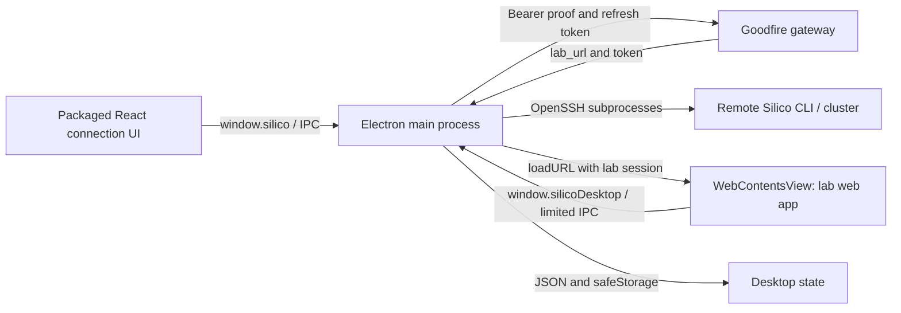

# Silico desktop main process

Silico 0.137.0 packages a connection manager and native desktop shell. Its main process discovers lab deployments, authenticates the user, starts or updates remote clusters over SSH, obtains lab session tokens, and embeds the lab's web application. The complete lab application is not established by this desktop bundle: the shell loads it from a URL returned by the gateway.

## Evidence and scope

This report is a **static reading of shipped JavaScript**, not a runtime test or an independent backend audit. No application code, SSH command, installer, API request, or user-profile inspection was executed for this analysis. The command examples below describe what Silico's code would execute.

- Archive: `/Applications/Silico.app/Contents/Resources/app.asar`, SHA-256 `568c230add76b26ba62acfd25021824fe01a914e558b05ad0d8bc1352d5071da`.
- Main member: `out/main/index.js`, SHA-256 `56c0d54f7d2dca103b15a3fe1315d67f29b12649ed824629a3b5713654319089`.
- Citation target **M**: [formatted main process](../evidence/main-analysis/main.js), SHA-256 `cc9f30f27393c5d3b6383c87c1879de35d80f68c2b226534d5ea38e4c56b3af6`, 7,803 lines. This local, ignored derivative was produced with Prettier's Babel parser from the extracted member. Line references below refer to this derivative. Retain its hash if regenerating with another formatter version or configuration.
- Preloads: [connection-shell bridge](../extracted/app/out/preload/index.js) and [lab bridge](../extracted/app/out/preload/lab.js). Each is one minified module.

The **M** references are ordinary source evidence, distinct from any REA-generated Evidence IDs in the parent investigation.

## Process and trust boundaries

The packaged shell exposes `window.silico`, including authentication, settings, connections, SSH configuration, lab lifecycle, update, and view navigation methods. The separately loaded lab receives `window.silicoDesktop`: recovery, notifications, badge counts, browser-return coordination, foreground events, shell-event draining, settings, and the lab switcher. Neither preload exposes a general-purpose filesystem or process API.

The privileged connection-shell IPC wrapper checks the sender frame URL: a `file:` URL or the configured development renderer origin is accepted (M 6418–6437). This is a URL-class check, not an exact packaged-file allowlist. Lab IPC uses membership in the `persist:silico` Electron session partition for many handlers (M 6439–6441, 6671–6724). Session recovery has a narrower check: registered eligible contents, a live main frame, and recovery eligibility (M 2648–2665). These checks are observed implementation boundaries; static reading does not establish the impossibility of an unintended navigation or malicious sender.

Windows with the connection preload explicitly enable `contextIsolation` and disable `sandbox` (M 3133–3143). Embedded lab views select `persist:silico`, load the lab preload, and disable background throttling; other webPreferences use Electron defaults where not explicitly specified (M 3718–3724). Signup uses a separate `persist:silico-signup` partition (M 5297–5299). External HTTP(S) navigation and popup handling are mediated by URL classification (M 2180–2280, 3045–3125).

## Authentication and local state

**Observed sign-in path:** create a random nonce and a loopback HTTP callback server on `127.0.0.1` with an ephemeral port; launch the system browser to `/login?mode=desktop&redirect_uri=...`; require the callback path, exact loopback Host header, and matching nonce; accept a proof and optional activation code. The sign-in attempt has a three-minute timeout (M 1048–1073, 1746–1820).

With an activation code, the desktop creates a refresh token locally, hashes it with SHA-256, and sends only the hash in `POST /labs/activate` authenticated by the activation code. A valid activation response allows retaining the locally generated refresh token. Certain transient failures fall back to the proof-only session (M 1635–1680). A proof is refreshed within five minutes of expiry using `POST /labs/refresh` and the refresh token. Refresh validates returned identity, issuer, and purpose fields and checks whether the active account changed during the asynchronous operation (M 1556–1632).

Identity persistence uses Electron `safeStorage` encryption for the proof and refresh token when available in a packaged, non-test build. The encrypted strings are base64-encoded in `identity.json`; identity metadata remains ordinary JSON. Packaged builds without usable encryption decline persistence; development builds have an explicit plaintext fallback. Backend mismatch or decryption failure becomes a signed-out state. The code has a test-mode path keyed by `SILICO_E2E_USER_DATA`; it is not evidence that the installed app was launched in that mode (M 1122–1299).

Sign-out tracks refresh-token revocations using `pending-revocations` and retries `/labs/logout`; 401 and 404 are treated as already revoked. The retry interval is 30 seconds (M 1259–1265, 1390–1541). Account identity and reference checks throughout session exchange prevent a response from an older account being adopted after a concurrent sign-out or sign-in (M 2017–2135).

| State | Static location or behavior |
|---|---|
| Saved connections | Electron userData `connections.json`, `{version: 1, connections: [...]}`; generated UUID when absent; serialized updates and temporary-file rename (M 164–204) |
| Settings | `settings.json`; staging, verbose logging, preview builds, notification flags, developer mode, skip-version-check; migration logic and defaults (M 250–320) |
| Last-opened lab | `last-opened.json` under userData (M 481 onward) |
| Identity | `identity.json`, with safeStorage behavior above |
| Pending sign-outs | `pending-revocations` under userData |
| Browser state | Persistent lab and signup session partitions |
| SSH config | `~/.ssh/config`; parser reads ordinary literal Host entries and writer appends a validated host block (M 4896–4978) |
| SSH host trust | `~/.ssh/known_hosts`; append after a fresh key scan (M 910–947) |
| Update handoff | `update-exit-marker.json` under userData (M 5174–5210) |

These paths are recovered from code. Their current contents were not inspected.

## Three connection paths

### Managed lab

The gateway inventory supplies deployment metadata including `kind`, deployment ID, public host, current/target/minimum SHA, staleness, and update flags. `kind` maps to managed, local, or cluster (M 2137–2154). A managed connection exchanges its deployment ID for `{token, lab_url}` at `/labs/session`, probes readiness, then loads `/auth/callback?return_to=...#token=...` in an embedded view (M 4248–4309).

Readiness is a client heuristic: `/api/cluster/version` is requested with a bearer lab token; 425 or 5xx is “warming,” while other HTTP responses are classified “ready.” A managed front-door probe checks `/healthz/dataplane` when the version probe cannot connect. The normal managed wake budget is 90 seconds with 1.5-second polling (M 949–1042). “Ready” in this state machine should not be described as proof that every lab API is healthy or authorized.

### Local development stack

Local discovery runs `docker ps` restricted by a `silico-local-` container-name filter, reading published ports and worktree/branch labels. It recognizes mappings to container port 5173 (M 146–162, 6462–6478). Opening a local connection probes `/healthz`, then still calls the Goodfire gateway `/labs/session` with `deployment_id` and `lab_url`. The resulting URL/token enter the same embedded login callback path (M 4312–4344).

**Inference:** running a local web server by itself does not reproduce an authenticated local Silico connection; the observed shell path still depends on the gateway, unless the reconstruction deliberately replaces that backend with a documented mock.

### SSH cluster

OpenSSH is invoked as an external executable with argument arrays. The client restores `PATH` and `SSH_AUTH_SOCK` from the user's login shell. Baseline SSH options include noninteractive `BatchMode=yes`, a ten-second connection timeout, optional identity file with `IdentitiesOnly=yes`, port, and jump host. Passphrase prompting is not implemented (M 631–815).

The connect state machine checks for `~/.silico/deployment.toml`. For a new production cluster it obtains a setup bearer from the gateway, then runs a remote install pipeline using the gateway `/install` script and environment variables for tenant and authorization. Existing production clusters run `silico up`; staging uses `silico-dev` and verifies a dev CLI and checkout. Required or pinned-version discrepancies can route through update before opening the lab (M 4611–4787).

The code's remote lifecycle operations include:

- Initial setup: download the gateway installer through `curl`, pipe to Bash, passing tenant and setup authorization (M 4638–4650).
- Start: `silico up` or `silico-dev up`, optionally verbose (M 4738–4752).
- Update: obtain a fresh setup bearer, then invoke the selected CLI's `update`, optionally `--preview` (M 4788–4868).
- Stop: invoke the selected CLI's `down --yes` (M 4873–4893).

A session exchange that returns HTTP 409 can trigger route claiming. The shell reads `~/.silico/state/claim.token` (or `state/_dev/claim.token`) over SSH, hashes it, and POSTs the hash to `/labs/claim`. A conflicting stale route produces an instruction for a browser claim URL (M 4350–4369, 4581–4607).

For private/loopback lab routes or an explicitly selected tunnel, the shell reads `lab-host.txt` and `lab-port.txt` over SSH, allocates a local port, and starts `ssh -N -L localPort:labHost:labPort`. Keepalive is 15 seconds with three missed responses; `ExitOnForwardFailure=yes` is set. It retries dropped tunnels with exponential delays capped at eight seconds, up to six retries, and rereads the remote host/port before reconnecting (M 3934–4145). This is port forwarding, not a bundled lab server.

Host-key discovery invokes `ssh -G`, `ssh-keyscan`, and `ssh-keygen`; automatic key fetch explicitly declines jump-host cases (M 847–909). The accept operation performs a new scan and appends the returned keys. It does not take the previously displayed fingerprint as an argument, so scan/accept continuity is an area to test if reproducing this UX; no attack or runtime failure was demonstrated (M 910–947).

## Backend contract recovered from call sites

Gateway origins are allowlisted as `https://my.silico.run` and its staging equivalent. Selected requests have known fallback origins at `https://silico.goodfire.com` and its staging equivalent. The gateway fetch wrapper rejects unknown input origins before constructing requests (M 211–226, 1882–1918).

| Endpoint | Request / response role observed in shell |
|---|---|
| `GET /login?mode=desktop&redirect_uri=...` | System-browser login; callback proof and optional activation code (M 1048–1051) |
| `POST /labs/activate` | Activation-code bearer; body `token_hash`; response `ok` (M 1638–1677) |
| `POST /labs/refresh` | Refresh-token bearer; response `proof` (M 1564–1607) |
| `POST /labs/logout` | Refresh-token bearer; revocation (M 1478–1500) |
| `GET /labs` | Proof bearer; response `labs` with deployment/version metadata (M 1947–1968, 2137–2154) |
| `POST /labs/session` | Proof bearer; body `deployment_id`, optional `lab_url`; response `token`, `lab_url` (M 2017–2058) |
| `POST /labs/claim` | Proof bearer; deployment ID and claim-token hash; response lab session (M 2060–2099) |
| `POST /labs/setup-bearer` | Proof bearer; deployment ID; response `setup_bearer` (M 2101–2135) |
| `POST /beta-signup/desktop-continue` | Signup continuation; response includes `resume_token` (M 1973–1998) |
| `GET /install` | Remote cluster installer consumed over SSH (M 4638–4643) |
| Lab `GET /api/cluster/version` | Token-bearing readiness probe (M 954–965) |
| Lab `/healthz`, `/healthz/dataplane` | Reachability and managed-front-door probes (M 974–992, 2318–2331, 4155 onward) |
| Lab `/auth/callback?...#token=...` | Session handoff to loaded lab application (M 4300–4308, 4334–4342, 4404–4413) |

These are observed call sites, not a complete server API specification. The token fragment avoids putting that token in the callback HTTP query; actual browser history, frontend token handling, logging, redirects, and server validation were not observed.

## Recovery, deep links, notifications, and updates

The shell tracks embedded-view loading/shown/hidden state, navigation, active lab, and recovery epochs. A rendered-page probe checks whether the lab root mounted or remains empty/on its boot placeholder. Managed lab health and dead-page strikes can trigger bounded recovery; render-process crash recovery is also bounded (M 2285–2415, 3700–3869). This explains why a replica needs coordinated lifecycle state rather than only an iframe and connection list.

The custom `silico:` protocol supports signup, signup-resume, signup-ready, checkout-return, MCP OAuth return, GitHub connect return, and welcome flows. Browser-return operations issue random nonces bound to web contents and connection identity, enforce expiry, and consume nonce mappings once. Checkout uses a 30-minute window; MCP/GitHub return nonces use 15 minutes. MCP returned payloads are bounded and temporarily queued for delivery to the lab (M 1085–1121, 5274–5295, 6245–6413). These are frontend-return coordination mechanisms; the desktop does not implement the external services' authorization servers.

Notifications and badges originate in the lab bridge and are filtered/normalized in main-process handlers. Foreground and shell events are delivered back to lab pages; the shell event buffer is capped at 100 records (M 89–145, 580–615, 3880–3932, 6190–6244). Notification categories include input-needed and experiment-finished. These names alone do not establish the execution engine or experiment data model.

The permission handlers permit sanitized clipboard writes and fullscreen. Audio capture requires the lab partition, main-frame audio-only request, eligible lab URL, and explicit microphone confirmation; the result is cached per webContents/origin. Other permission requests are denied by this handler (M 6882–6951). The UI text says dictation audio is sent to the lab transcription service; the transcription implementation is not present in the inspected main-process path.

Updates use `electron-updater`, automatic download, and install-on-quit, with additional macOS staging/relaunch and Windows signature-verification logic (M 5500–5650, 5670–6085). Update delivery and trust-chain validity were not exercised. Packaged startup also rejects a set of debugging and certificate-bypass flags, with a narrow test-mode exception (M 1215–1235); do not assume an ordinary `--remote-debugging-port` launch will work.

## Reconstruction boundary

**Directly reconstructable from this evidence:** desktop connection models; the preload API contract; local connection/settings persistence; shell states and error messaging; SSH orchestration, host-key UX and tunneling; gateway request/response shapes used here; view lifecycle; browser-return routing; notifications; update UX.

**Requires additional evidence or an explicit substitute:** full remotely served lab UI and routes; experiment execution and storage; lab backend implementation; gateway auth/token verification; cluster installer/CLI source; deployment orchestration; billing/OAuth backends; transcription service. The bundle shows where these systems are called, not their implementation.

A useful local reconstruction can implement the recovered shell contract against deterministic fake labs and fake authentication, then separately add real adapters. It should label those mocks explicitly and preserve an unambiguous boundary between reconstructed behavior and verified Silico behavior. Achieving functional parity with the entire hosted product is not supported by the desktop bundle alone.
